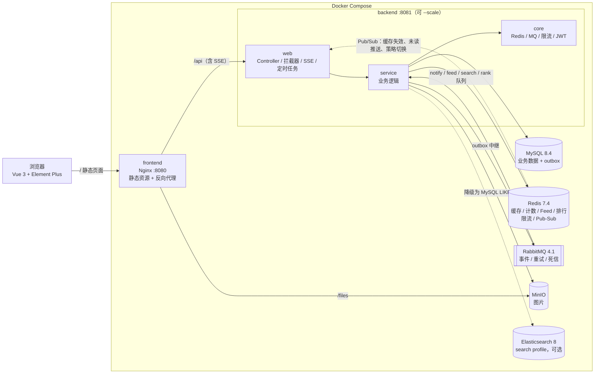
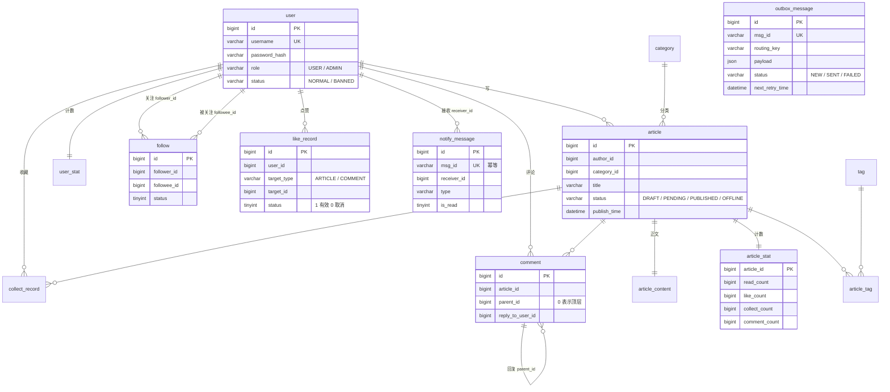
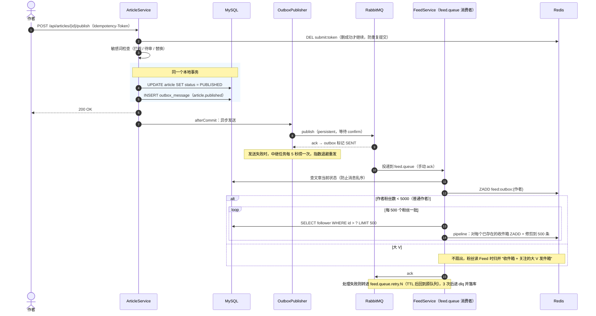
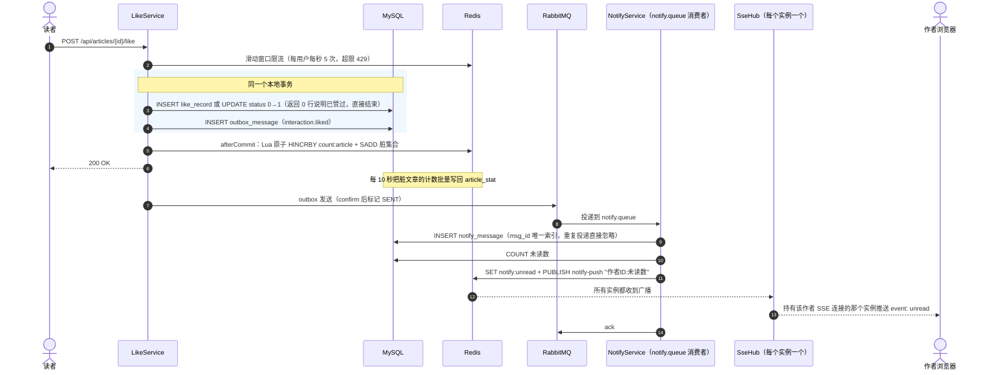

# code-nest（码巢）

一个面向学习的开发者社区（写文章、点赞评论、关注动态、通知、排行、搜索、管理后台），用 Java 17 + Spring Boot 3.5 + Vue 3 实现。业务设计参考了 [技术派](https://github.com/itwanger/paicoding)（`springboot3&vue3` 分支），没有复制它的代码。

和一般的 CRUD 项目不同，这里有三处设计可以**在运行时切换实现**，并配了并发测试和压测来对比：

| 实验 | 可选值（加粗为默认） | 对比什么 |
|---|---|---|
| 计数 `app.count.strategy` | naive / atomic-sql / **redis-batch** | 并发下的准确性、数据库写入次数 |
| 关注动态 `app.feed.mode` | push / pull / **hybrid** | 读耗时、大 V 发文的扇出耗时和内存 |
| 缓存 `app.cache.mode` | none / redis / **two-level** | 热点文章详情的吞吐和延迟 |

压测结论见 [docs/perf-report.md](docs/perf-report.md)，每个里程碑的学习笔记见 [docs/learn/](docs/learn/README.md)，选型理由见 [docs/decisions.md](docs/decisions.md)，踩坑记录见 [docs/pitfalls.md](docs/pitfalls.md)。

---

## 目录

- [当前状态](#当前状态)
- [功能](#功能)
- [架构](#架构)
- [数据模型](#数据模型)
- [两条关键链路](#两条关键链路)
- [快速开始](#快速开始)
- [本机开发](#本机开发)
- [测试](#测试)
- [造数与压测](#造数与压测)
- [双实例演示](#双实例演示)
- [Windows 注意事项](#windows-注意事项)
- [工程结构](#工程结构)
- [致谢](#致谢)

## 当前状态

> 更新于 2026-10-23。

- **完成度**：规划的功能（[docs/SPEC.md](docs/SPEC.md)）已全部实现，GitHub Actions 上的单元测试、集成测试和前端构建都能通过。还没有在 Windows 本机上跑过完整测试。
- **代码来源**：代码主要由 AI（Claude）生成；需求拆解、方案取舍由作者决定，作者按 [docs/learn/](docs/learn/README.md) 逐个模块读懂代码。
- **压测数据**：[docs/perf-report.md](docs/perf-report.md) 里的数据是 2026-10-22 在云端容器（4 核 Intel Xeon @ 2.80GHz，15 GB 内存）里跑的，JMeter、后端和中间件在同一台机器上，只能用来比较同一场景下不同实现的差异。之后会在作者的电脑（Windows 11，Intel Core Ultra 5 125H，16 GB 内存）上重跑，并替换报告正文。
- **ES 搜索**：代码已经写完（IK 分词，标题、摘要、正文高亮，ES 出错时降级为 MySQL `LIKE`），但 Elasticsearch 还没有真正跑起来过：开发环境下载不了 IK 插件（见 [P-006](docs/pitfalls.md)）。和搜索有关的测试只有 `HighlightTest`，测的是降级路径里的关键词高亮；ES 那一侧没有测试，集成测试和压测也都没有覆盖搜索。默认 `SEARCH_ENABLED=false`，搜索走 MySQL 降级路径。
- **演示视频**：还没有录，录好后把链接放在这里。

## 功能

- **账号**：注册、登录、双令牌（JWT + 可轮换的刷新令牌）、登录失败锁定、修改资料和密码、头像上传（MinIO）。
- **文章**：Markdown 编辑器、草稿自动保存、防重复提交、分类和标签、敏感词三级处理（拦截 / 待审 / 替换）。
- **互动**：点赞、收藏、两级评论、评论点赞，计数三种策略可切换。
- **关注与 Feed**：关注 / 粉丝列表，关注动态三种模式可切换，游标分页、关注回填、冷启动。
- **通知**：点赞、收藏、评论、回复、关注、系统通知，SSE 实时推送未读数（多实例可用）。
- **排行与搜索**：活跃作者日 / 周 / 月榜，热门文章；Elasticsearch 全文搜索，不可用时自动降级 MySQL。
- **管理端**：看板（HyperLogLog 日活）、审核、下架、封禁、分类标签、敏感词、死信重放、操作日志、实验开关。
- **工程**：统一返回、全局异常、traceId、限流注解、outbox 本地消息表、重试队列和死信、Flyway、Testcontainers 集成测试、GitHub Actions。

## 架构



- 后端分四个 Maven 模块：`api`（DTO、VO、枚举）← `core`（与业务无关的基础设施）← `service`（业务）← `web`（入口），依赖只能从右往左。
- 所有"写完数据库还要通知别人"的场景都走 **outbox 本地消息表 → RabbitMQ**，消费者手动 ack，失败进 TTL 重试队列（1s / 5s / 30s），再失败进死信队列并落库。
- 多实例之间需要同步的状态（本地缓存失效、SSE 推送、敏感词重载、策略切换）走 **Redis Pub/Sub**；定时任务用 **Redisson 锁 + 按周期去重标记** 保证只在一个实例执行。

## 数据模型

19 张表，全部由 Flyway `V1__init_schema.sql` 创建。下图只画主要字段和关系：



另外几张独立的表：`dead_letter_message`（死信）、`sensitive_word`、`rank_snapshot`（榜单归档）、`daily_stat`（看板归档）、`admin_audit_log`（审计）、`user_stat`、`tag`、`category`。

## 两条关键链路

### 发文 → Feed 扇出（hybrid 模式）



### 点赞 → outbox → 通知



## 快速开始

只需要 Docker（Windows / macOS 用 Docker Desktop，内存至少分 6 GB）。

```bash
git clone https://github.com/qq3939/code-nest.git && cd code-nest
cp .env.example .env          # 按注释修改密码；JWT_SECRET 用 openssl rand -base64 48 生成
docker compose up -d --build  # 第一次构建镜像需要几分钟
docker compose ps             # 等所有服务变成 healthy
```

| 地址 | 说明 |
|---|---|
| http://localhost:8080 | 前端 |
| http://localhost:8080/admin | 管理端（账号密码是 `.env` 里的 `ADMIN_USERNAME` / `ADMIN_PASSWORD`） |
| http://localhost:8081/swagger-ui.html | 接口文档 |
| http://localhost:8081/api/health | 健康检查（含各中间件状态） |
| http://localhost:15672 | RabbitMQ 管理台 |
| http://localhost:9001 | MinIO 控制台 |

可选组件：

```bash
# 全文搜索：先把 .env 里的 SEARCH_ENABLED 改成 true
docker compose --profile search up -d --build
# 监控：Prometheus :9090，Grafana :3000
docker compose --profile monitoring up -d
```

停止：`docker compose down`；连数据一起清掉：`docker compose down -v`。

## 本机开发

后端在 IDE 或命令行里跑，中间件仍然用 Compose：

```bash
docker compose up -d mysql redis rabbitmq minio minio-init

# 后端（dev profile 会直接读取仓库根目录的 .env）
cd backend
./mvnw -pl code-nest-web -am spring-boot:run -Dspring-boot.run.profiles=dev
# Windows：mvnw.cmd -pl code-nest-web -am spring-boot:run "-Dspring-boot.run.profiles=dev"

# 前端（另开一个终端），Vite 把 /api 代理到 8081
cd frontend
npm ci
npm run dev        # http://localhost:5173
```

Spring profile：`dev`（本机跑后端）、`docker`（全在 Compose 里）、`test`（集成测试）、`prod`（关闭实验开关和接口文档）、`datagen`（造数，跑完退出）、`perf`（压测时放宽登录限流）。

## 测试

```bash
cd backend
./mvnw -B verify          # 单元测试 + 集成测试（需要 Docker，Testcontainers 会自动起 MySQL、Redis、RabbitMQ）
./mvnw -B test            # 只跑单元测试，不需要 Docker

cd frontend
npm run type-check && npm run build
```

集成测试覆盖：鉴权（令牌过期、轮换、锁定、封禁）、文章流程（草稿、防重复提交、敏感词、点赞评论通知、限流）、三种计数策略的并发准确性、消息可靠性（幂等、死信与重放、outbox 中继）、三种 Feed 模式结果一致、缓存（更新可见、空值缓存、跨实例失效广播）、定时任务锁（互斥与按周期去重）。

## 造数与压测

```bash
# 1. 造数：1 万用户、5 万文章、30 万关注（4 个大 V 各 6000 粉丝）、30 万点赞等，约 1 分钟
cd backend && ./mvnw -B -DskipTests package && cd code-nest-web
java -jar target/app.jar --spring.profiles.active=dev,datagen

# 2. 带 perf profile 启动后端
java -Xmx1g -jar target/app.jar --spring.profiles.active=dev,perf

# 3. 回到项目根目录，准备令牌和 CSV，然后跑压测（JMeter 在 Docker 里运行，不用安装）
cd ../..
bash perf/prepare.sh
bash perf/run.sh all      # 或 1 / 2 / 3 / 4 / 5 单独跑；RUNS、THREADS、DURATION 可调
```

每个场景的汇总表写在 `perf/results/scenario-N.md`，整理后的报告见 [docs/perf-report.md](docs/perf-report.md)。实验开关也可以在管理端"实验开关"页手动切换后自己体验。

## 双实例演示

```bash
docker compose up -d --build --scale backend=2
docker compose restart frontend     # 让 Nginx 重新解析到两个后端实例
docker compose logs -f backend      # 观察请求落在哪个实例
```

可以验证三件事（详细步骤见 [docs/learn/M6.md](docs/learn/M6.md)）：

1. **两级缓存失效广播**：在一个实例上修改文章，另一个实例的本地缓存同时被清掉，刷新立即看到新内容。
2. **SSE 跨实例推送**：两个浏览器分别登录，SSE 连接可能落在不同实例，点赞后对方的小红点仍然实时变化。
3. **定时任务只在一个实例执行**：日志里 `count flushed`、`hot articles refreshed` 只出现在拿到锁的实例。

## Windows 注意事项

- **换行符**：仓库有 `.gitattributes`（`* text=auto eol=lf`），脚本统一用 LF。如果 clone 之前改过 `core.autocrlf`，Shell 脚本出现 `\r: command not found` 时，执行 `git config --global core.autocrlf input` 后重新 clone 一次。
- **Docker Desktop 内存**：Settings → Resources 里至少分 **6 GB**；开 ES 时建议 8 GB。
- **ES 的 `vm.max_map_count`**：ES 要求至少 262144。WSL2 后端下执行：
  ```powershell
  wsl -d docker-desktop sysctl -w vm.max_map_count=262144
  ```
  重启电脑后会失效；想永久生效，在 `%USERPROFILE%\.wslconfig` 里加：
  ```ini
  [wsl2]
  kernelCommandLine = "sysctl.vm.max_map_count=262144"
  ```
- **端口占用**：启动前检查 8080、8081、3306、6379、5672、15672、9000、9001、9200 是否被占用（`netstat -ano | findstr :3306`）。本机装了 MySQL 服务的话先停掉，或者改 `docker-compose.yml` 里的端口映射。
- **Maven Wrapper**：Windows 用 `mvnw.cmd`；PowerShell 里 `-D` 参数要加引号。
- **压测脚本**：`perf/*.sh` 是 Bash 脚本，在 Git Bash 或 WSL 里执行。

## 工程结构

```
code-nest/
├── backend/                     Maven 多模块（Java 17，Spring Boot 3.5）
│   ├── code-nest-api/           DTO、VO、枚举、事件定义
│   ├── code-nest-core/          统一返回、JWT、Redis、MQ 拓扑、限流、敏感词前缀树、分布式锁
│   ├── code-nest-service/       业务：用户、文章、计数、互动、关注、Feed、通知、outbox、排行、搜索、缓存、管理
│   └── code-nest-web/           Controller、拦截器、SSE、定时任务、造数、Flyway 脚本、集成测试
├── frontend/                    Vue 3 + TypeScript + Vite + Element Plus + Pinia
├── deploy/                      Nginx、ES（带 IK 分词）、MinIO 初始化、Prometheus / Grafana
├── perf/                        JMeter 计划生成、压测脚本、结果
├── scripts/rename-project.sh    占位名替换脚本（已执行，见 D-027）
├── docs/
│   ├── SPEC.md                  需求规格
│   ├── decisions.md             技术选型记录
│   ├── pitfalls.md              踩坑记录
│   ├── perf-report.md           压测报告
│   └── learn/                   每个里程碑的学习笔记
├── docker-compose.yml
└── .env.example
```

## 致谢

业务功能和页面设计参考了 [技术派 paicoding](https://github.com/itwanger/paicoding)（`springboot3&vue3` 分支）。本项目是为了学习而重新实现的精简版，没有复制技术派的代码；代码主要由 AI 生成（见[当前状态](#当前状态)）。
