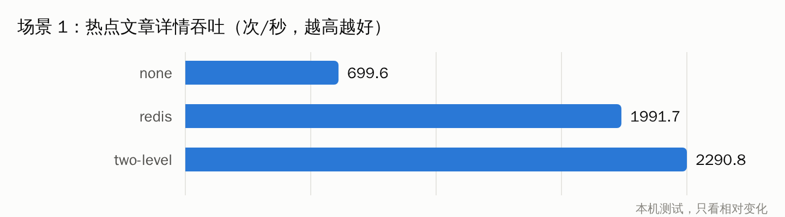
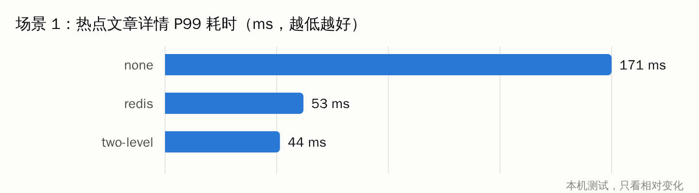
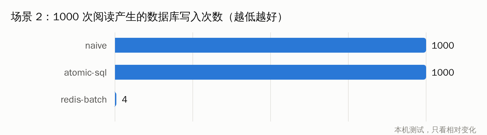
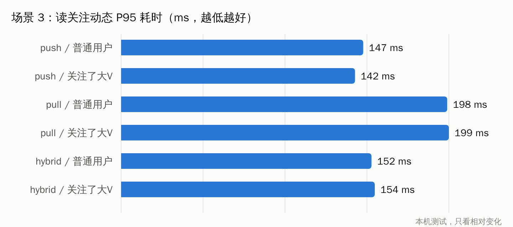

# 压测报告

> **本机测试，只看相对变化。** 压测机（JMeter）、后端和所有中间件跑在同一台机器上，互相争抢 CPU，绝对数值不能代表生产环境的容量，只能用来比较同一场景下不同实现的差异。

## 环境与方法

| 项目 | 值 |
|---|---|
| 机器 | 云端容器，Intel Xeon @ 2.80GHz，**4 核**，内存 15 GB |
| Docker | 29.9.1，中间件不单独限制资源（MySQL 8.4、Redis 7.4、RabbitMQ 4.1、MinIO） |
| 后端 | 本机 `java -Xmx1g -jar app.jar --spring.profiles.active=dev,perf`（单实例） |
| JMeter | 5.6.3（`alpine/jmeter` 镜像），非 GUI 模式 |
| 线程数 / 时长 | 场景 1、3：50 线程，每次 20 秒，先预热 10 秒；场景 2：50 线程 × 20 次；场景 5：5 线程 × 10 秒 |
| 重复 | 每组 3 次，取中位数 |
| 数据 | 造数 profile：1 万用户、5 万文章、30 万关注（4 个大 V，各约 6000 粉丝）、30 万点赞、6 万收藏、10 万评论 |
| 日期 | 2026-10-22 |

- 每组之间通过管理端接口切换策略（`PUT /api/admin/dev/strategies`），其他条件不变。
- `perf` profile 只放宽了登录、注册、搜索、发文的限流（准备数据和场景 4 需要），并把访问令牌有效期延长到 12 小时；点赞限流保持默认，供场景 5 测试。
- 复现：见 README 的"造数与压测"一节，`bash perf/prepare.sh && bash perf/run.sh all`。原始汇总在 `perf/results/scenario-N.md`。
- **没有测的**：ES 搜索（本机环境下载不了 IK 分词插件，ES 没跑起来），需要在自己电脑上用 `--profile search` 补测。

---

## 场景 1：热点文章详情，对比缓存模式

90% 的请求集中在 10 篇热点文章，10% 随机分布在其他文章，请求 `GET /api/articles/{id}`（匿名）。

| 缓存模式 | 吞吐（次/秒） | 平均（ms） | P50 | P95 | P99 | 错误率 |
|---|---|---|---|---|---|---|
| none | 699.6 | 61.0 | 54 | 123 | 171 | 0% |
| redis | 1991.7 | 18.5 | 17 | 35 | 53 | 0% |
| **two-level（默认）** | **2290.8** | **15.2** | **13** | **31** | **44** | 0% |

**结论**
- 加 Redis 缓存后吞吐提升到约 **2.8 倍**，P99 从 171ms 降到 53ms：省掉了每次请求的 4～5 次 SQL（文章、正文、分类、标签、作者）和对象组装。
- 再加一层本地缓存，吞吐再提升约 **15%**，P99 再降 17%：省掉了 Redis 网络往返和 JSON 反序列化。提升幅度不如第一步大，因为详情接口里仍有不走缓存的部分（阅读数 +1、读计数、查当前用户是否点赞），这部分成为新的瓶颈。
- 第一轮压测时 redis / two-level 模式有 7%～12% 的 500 错误，原因是没开 Lettuce 连接池，见 pitfalls P-017；开池后重跑，错误率为 0。

## 场景 2：并发阅读同一篇文章，对比计数策略

50 个线程各读同一篇文章 20 次（共 1000 次），记录阅读数实际增加了多少、MySQL 的 `Com_update + Com_insert` 增加了多少。redis-batch 在读取前触发一次写回，把 Redis 里的计数刷到数据库后再比较。

| 计数策略 | 吞吐（次/秒） | 平均（ms） | P95 | P99 | 实际增加 | 准确率 | 数据库写入次数 |
|---|---|---|---|---|---|---|---|
| naive | 206.4 | 6.5 | 11 | 17 | 789 | **78.9%** | 1000 |
| atomic-sql | 206.8 | 6.1 | 11 | 18 | 1000 | 100% | 1000 |
| **redis-batch（默认）** | 208.7 | **3.1** | **5** | **8** | 1000 | 100% | **4** |

**结论**
- naive（先读后写）在 50 并发下丢了约 **21%** 的更新；集成测试里 200 线程同时开跑时，1000 次只剩 20 多次（`CountConcurrencyIT`）。并发越集中丢得越多。
- atomic-sql 准确，但每次阅读都是一次数据库写：1000 次阅读 = 1000 次 UPDATE，并且都在抢同一行的行锁。
- redis-batch 同样准确，数据库写入从 1000 次降到**个位数**（写回是"每批脏文章一条 upsert"），接口平均耗时减半。
- 吞吐三者几乎一样，是因为这个场景用固定次数（每线程 20 次）而不是固定时长，吞吐主要受线程启动节奏限制，比较意义不大；看耗时和写入次数即可。

## 场景 3：读取关注动态，对比 Feed 模式

两组用户各 200 个：**普通用户**（关注 20 人以上，不关注大 V）和**关注了大 V 的用户**。平均每个用户关注约 30 人。请求 `GET /api/feed?size=20`（第一页），每次切换模式后先预热一轮，让收件箱按新模式冷启动重建。

| 模式 / 用户 | 吞吐（次/秒） | 平均（ms） | P50 | P95 | P99 | 错误率 |
|---|---|---|---|---|---|---|
| push / 普通用户 | 500.9 | 83.8 | 81 | 147 | 192 | 0% |
| push / 关注了大 V | 528.6 | 78.4 | 75 | 142 | 187 | 0% |
| pull / 普通用户 | 339.0 | 123.4 | 124 | 198 | 247 | 0% |
| pull / 关注了大 V | 346.5 | 124.4 | 124 | 199 | 237 | 0% |
| hybrid / 普通用户 | 485.3 | 84.8 | 83 | 152 | 205 | 0% |
| hybrid / 关注了大 V | 457.3 | 90.8 | 89 | 154 | 198 | 0% |

**结论**
- 读性能 push ≥ hybrid > pull。pull 每次要读约 30 个发件箱再在内存里归并，吞吐比 push 低约 **32%**，P95 高约 35%。
- hybrid 对普通用户和 push 基本持平（只读一个收件箱）；对关注了大 V 的用户多读 1～4 个大 V 发件箱，吞吐比 push 低约 13%，仍明显好于 pull。
- 这一组的耗时大头不在 Redis，而在"拿到 20 个文章 ID 之后组装列表"（查文章、作者、标签、计数、状态过滤），所以三种模式的差距没有理论上那么大。关注人数越多，pull 的劣势越明显。

## 场景 4：大 V 发文，对比扇出耗时和内存

大 V `dg_user00001`，粉丝 6016 人。模拟"所有粉丝都活跃"：发文前给每个粉丝建好收件箱。push 模式测量"发布接口返回 → 最后一个粉丝的收件箱里出现这篇文章"的时间；Redis 内存取 `INFO memory` 的 `used_memory` 差值。

| 模式 | 扇出完成耗时 | Redis 内存增量 | 说明 |
|---|---|---|---|
| push | **664 ms** | 约 +91 KB | 发文时写入 6016 个收件箱 |
| **hybrid（默认）** | 不扇出（0） | 约 0（测得 −46 KB，属于测量噪声） | 大 V 只写自己的发件箱，粉丝读的时候再合并 |

**结论**
- push 模式下扇出耗时与粉丝数成正比：6016 个粉丝用了约 0.66 秒（每批 500 个粉丝一次 pipeline），按此线性估算，100 万粉丝的大 V 发一篇文章要扇出约 **110 秒**，期间占用消费者线程，并写入 100 万个收件箱（数十 MB 内存）。
- hybrid 让大 V 发文的写入成本变成常数（一次 ZADD），代价是关注了大 V 的用户读 Feed 时要多读几个 ZSet（场景 3 里约 −13% 吞吐）。这正是推拉结合的取舍：**用少数人读时的一点开销，换掉大 V 写时的巨大开销**。
- Redis 内存的测量粒度较粗：小 ZSet 用 listpack 紧凑编码，每个成员十几个字节，6000 个成员只有约 90 KB，和 Redis 自身的内存波动在同一个量级。

## 场景 5：点赞限流

规则：每个用户每秒最多 5 次点赞类操作（滑动窗口）。5 个线程使用同一个用户的令牌，连续点赞 / 取消点赞 10 秒，跑 3 轮。

| 状态码 | 次数 | 占比 |
|---|---|---|
| 200 | 150 | 0.6% |
| 429 | 26002 | 99.4% |

被限流请求的 P99 为 22ms，吞吐（中位数）约 940 次/秒。

**结论**
- 3 轮共 30 秒，放行恰好 **150 次 = 30 秒 × 每秒 5 次**，滑动窗口限流精确生效，没有出现固定窗口在边界处"两倍突刺"的问题。
- 被限流的请求在 Lua 脚本判断后直接返回 429，不进入业务逻辑，也不访问 MySQL，所以即使被刷，数据库压力也不会上升。

---

## 双实例演示

用 `docker compose up -d --build --scale backend=2` 启动两个后端实例（步骤见 [learn/M6.md](learn/M6.md)），结果如下：

| 验证项 | 做法 | 结果 |
|---|---|---|
| 请求分到两个实例 | 经 Nginx（:8080）请求 40 次 `/api/categories`，再分别看两个实例的 `http.server.requests` 计数 | 19 次 / 21 次，轮询生效 |
| 两级缓存失效广播 | 先分别直接请求两个实例（:8081、:8082）的同一篇文章详情，两边本地缓存都有了；再通过 :8081 修改标题，0.3 秒后再分别请求 | 两个实例都立即返回新标题。本地缓存 TTL 是 60 秒，:8082 能读到新值只能是收到了广播 |
| SSE 跨实例推送 | 作者在 :8082 建立 SSE 连接；另一个用户在 :8081 点赞 | :8082 上的连接先收到 `unread:0`，点赞后收到 `unread:1` |
| 定时任务只在一个实例执行 | 两个实例相差 0.8 秒启动，观察启动 30 秒后的热门文章重算日志 | 只有 backend-2 打印 `hot articles refreshed`；Redis 里出现 `lock:job:hot-score:ran` 标记 |

检查这一项时发现一个问题：只靠分布式锁，两个实例的定时器只要相差几百毫秒触发，后到的实例在先到的实例跑完、释放锁之后照样能再跑一遍（锁只保证"不同时跑"）。已给低频任务（热门重算、榜单归档、看板归档、对账）加上"最短间隔"标记，见 pitfalls P-018，并补了 `JobLockIT`。

> 说明：本次的云端环境里，`docker build` 阶段访问不了 Maven 中央仓库，所以演示用的镜像是把本机已经打好的 `app.jar` 和前端 `dist` 直接拷进运行时镜像构建的（运行时镜像、Compose 编排、Nginx 配置与仓库里完全一致）。在普通网络环境下直接 `docker compose up -d --build` 即可。

## 总体结论

1. **缓存是性价比最高的优化**：热点读场景吞吐提升到约 3.3 倍、P99 降到约 1/4。两级缓存的增益在 Redis 之上还有约 15%，代价是多实例一致性需要广播来维护。
2. **高频计数不要直接写库**：redis-batch 把写入次数降了两个数量级，且准确；naive 的丢失更新是真实存在的，而且并发越高越严重。
3. **Feed 推拉结合是一个取舍而不是免费午餐**：hybrid 读性能接近 push，写成本对大 V 是常数，适合"大多数人粉丝很少、少数人粉丝极多"的社区。
4. **限流精确且廉价**：被拦截的请求不进业务、不碰数据库。
5. **压测发现了功能测试发现不了的问题**（Lettuce 连接池，P-017），这本身就是压测的价值。
